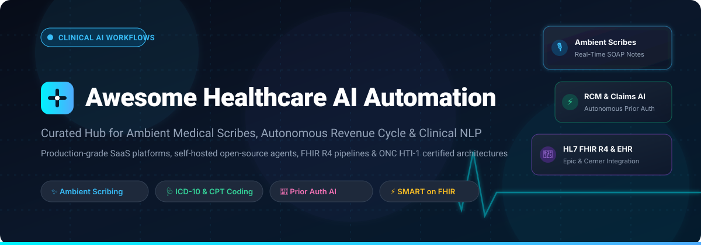

# 🎬 Awesome Healthcare AI Automation

<p align="center">
  
</p>

<p align="center">
  <a href="https://github.com/ishandutta2007/Awesome-Awesome-Awesome"></a><a href="https://discord.gg/jc4xtF58Ve"></a>
  <a href="https://github.com/ishandutta2007/Awesome-Healthcare-AI-Automation/stargazers"></a>
  <a href="https://github.com/ishandutta2007/Awesome-Healthcare-AI-Automation/network/members"></a>
  <a href="https://github.com/ishandutta2007/Awesome-Healthcare-AI-Automation/blob/main/LICENSE"></a>
  <a href="https://github.com/ishandutta2007"></a>
</p>

---

## 🚀 Top Healthcare AI Automation Ecosystem

**Curated List of SaaS Products & Open-Source GitHub Projects for Healthcare AI Engineers, Clinical Informaticists & Revenue Cycle Architects**  
*Focused on Ambient Clinical Documentation, AI Medical Scribes, Claims Automation, Clinical Coding & Hospital Workflow Orchestration*  

📅 **Last updated:** October 2026

---

### 💡 Overview & SEO Keywords

This repository tracks notable **SaaS platforms** and **open-source projects** for **Healthcare AI Automation**. In modern hospital operations and ambulatory practices, AI automation systems power ambient clinical documentation, automated medical coding, claims adjudication, prior authorization, and administrative workflow orchestration—reducing clinician burnout and accelerating revenue cycles.

Key architectural concepts and search keywords covered include:
- **Ambient Clinical Documentation**: AI medical scribes (Nuance DAX Copilot, Abridge, Suki AI, Nabla Copilot, Freed AI) that passively capture clinician-patient conversations and generate structured SOAP notes.
- **AI Medical Scribes & Speech Diarization**: Real-time transcription, speaker diarization (clinician vs. patient), and LLM-based note generation integrated into EHR workflows.
- **Claims Automation & Revenue Cycle Management (RCM)**: AI-driven medical billing, ICD-10-CM and CPT-4 code prediction, CMS-1500 and EDI X12 (837/835/276/277) claims processing, and autonomous prior authorization.
- **Clinical NLP & De-Identification**: Medical named entity recognition (NER), HIPAA Safe Harbor PHI de-identification, and clinical concept normalization (SNOMED-CT, UMLS, RxNorm, LOINC).
- **EHR & Interoperability Standards**: HL7 FHIR R4, SMART on FHIR, and vendor-specific APIs (Epic Systems, Oracle Health/Cerner, athenahealth) for seamless clinical data exchange and ONC HTI-1 certified decision support.

---

## 📋 Table of Contents

- [📊 Sector Overview & Market Dynamics](#-sector-overview--market-dynamics)
- [☁️ SaaS/Hosted Platforms](#️-saashosted-platforms)
- [🔓 Open-Source GitHub Projects](#-open-source-github-projects)
- [🏗️ Architectural Guidelines & Pipelines](#️-architectural-guidelines--pipelines)
- [🤝 How to Contribute](#-how-to-contribute)
- [💖 Support & Community](#-support--community)
- [⚠️ Disclaimer](#️-disclaimer)
- [⭐ Star History](#-star-history)

---

## 📊 Sector Overview & Market Dynamics

> 📈 **Market Size & Fragmentation:** The global healthcare AI automation market is estimated at **~$8.5 Billion** in 2026, projected to exceed **~$45 Billion by 2033** (CAGR ~28%). The sector exhibits a **moderately fragmented** structure: EHR mega-incumbents (Epic Systems, Oracle Health/Cerner) anchor core hospital records while partnering with specialized ambient vendors (Nuance DAX, Abridge, Ambience), whereas independent, agile EHR-agnostic AI scribes (Nabla, Suki, Freed AI, Heidi Health) dominate ambulatory clinics and specialty practices.

The sector dynamics are governed by several key drivers:
1. **Severe Documentation Burden:** US physicians spend an average of **~1.8 hours per day** on after-hours EHR documentation ("pajama time"), creating unprecedented demand for automated ambient documentation.
2. **Enterprise Consolidation vs. Fast Self-Serve:** Microsoft Nuance and Oracle Health dominate large hospital network contracts, while high-velocity self-serve ambient scribes (Nabla Copilot, Suki, Freed AI) capture individual clinicians and independent medical groups.
3. **Regulatory Mandates:** ONC HTI-1 rules enforce strict algorithm transparency, source attribute disclosure, and decision support intervention oversight across all certified health IT systems.

---

## ☁️ SaaS/Hosted Platforms

*Sorted by Company Size / Valuation (Descending) 🏢*

| Platform / Service | Company Size (Valuation / Revenue) ↓ | Pricing (Starting Tier) | Free Tier / Free Trial Limit | Key Focus & Capabilities |
| :--- | :--- | :--- | :--- | :--- |
| **[Oracle Health (Cerner)](https://www.oracle.com/health/)** | **~$28.3 Billion** Acquisition (Oracle, 2022) | **$25/user/month** (base cloud license; ambulatory clinic bundles from $1,000/provider/month) | **30-day free trial** for Oracle Cloud Infrastructure (OCI) services | Enterprise EHR with AI-native Clinical Digital Assistant. Voice-first workflows, automated order drafting, referral letters, and clinical trial matching. Integrated into OCI infrastructure. |
| **[Nuance DAX Copilot](https://www.nuance.com/healthcare/dragon-ai-clinical-solutions/dax-copilot.html)** | **~$19.7 Billion** Acquisition (Microsoft, 2022) | **$500/provider/month** (starting enterprise tier; ranges up to $700/provider/month) | **30-day free trial** for Dragon Medical speech solutions | Ambient clinical intelligence natively embedded in Epic Haiku, Canto, and desktop. Generates draft SOAP notes within seconds using Azure OpenAI GPT-4. |
| **[Abridge](https://www.abridge.com/)** | **~$5.3 Billion** Valuation (Series E, 2025) | **$165/provider/month** ($2,000/provider/year entry tier; enterprise scales to $250+/month) | **14-day guided enterprise pilot** upon clinician consultation | "Abridge Inside" purpose-built ambient documentation for Epic EHR. Dynamic specialty-tuned summaries with linked audio evidence. Powers Kaiser Permanente and Sutter Health. |
| **[Epic Systems](https://www.epic.com/)** | **~$4.5 Billion** Annual Revenue (Private, Verona, WI) | **$4,000/month** (via Community Connect/Garden Plot; enterprise hospital licenses scale to $1M+) | **60-day sandbox trial** via Epic Open-Developer Workshop | Dominant US hospital EHR with 250M+ patient records. AI ecosystem powered by Cosmos predictive models, Azure OpenAI integrations, and native ambient scribe hooks. |
| **[Innovaccer](https://innovaccer.com/)** | **~$3.2 Billion** Valuation (Series F, 2025) | **$25,000/year** (base single-clinic module; enterprise health system contracts start at $300,000/year) | **14-day interactive sandbox access** for developer API evaluation | Healthcare AI data platform automating hospital operations, care management, risk adjustment, and claims adjudication with agentic workflows. |
| **[Suki AI](https://www.suki.ai/)** | **~$1.3 Billion** Valuation (Series D, 2024) | **$299/provider/month** (annual billing; $399/provider/month billed monthly) | **14-day free trial** (unlimited ambient notes during trial) | Voice-first ambient AI assistant with multi-specialty coverage. EHR-agnostic with deep bidirectional integrations for Epic, Oracle Health/Cerner, and athenahealth. |
| **[Ambience Healthcare](https://www.ambiencehealthcare.com/)** | **~$1.0 Billion+** Valuation (Series C, 2025) | **$230/provider/month** ($2,800/provider/year for AutoScribe; full AI suite from $330/provider/month) | **14-day clinical department trial** upon onboarding verification | Full-stack clinical intelligence suite combining ambient scribing (AutoScribe), automated coding (AutoCDI), after-visit summaries (AutoAVS), and referral management (AutoRefer). |
| **[Nabla Copilot](https://www.nabla.com/)** | **~$500 Million** Valuation (Series C, 2025) | **$119/provider/month** (Pro plan with EHR extensions and specialty customization) | **Free tier forever**: 30 clinical notes/month with full SOAP generation | Ultra-fast ambient AI scribe operating in under 15 seconds. Works via web browser, Chrome extension, mobile app, and EHR copy/paste; trusted by 85,000+ clinicians. |
| **[DeepScribe](https://www.deepscribe.ai/)** | **~$330 Million** Valuation (Series B, 2023) | **$350/provider/month** (starter clinic tier; scales to $500/provider/month with custom templates) | **14-day evaluation trial** available for qualifying clinical practices | Specialty-focused AI medical scribe with real-time EHR write-back into 100+ platforms. Features specialized models for cardiology, oncology, orthopedics, and psychiatry. |
| **[Augmedix](https://www.augmedix.com/)** | **~$150 Million** Valuation (NASDAQ: AUGX) | **$1,500/provider/month** (Augmedix Go automated AI; live human-assisted scribe from $2,800/month) | **14-day clinical trial** for qualified hospital & urgent care groups | Hybrid ambient AI documentation platform pairing proprietary LLM models with human quality review. High reliability in high-throughput ER and urgent care environments. |
| **[Heidi Health](https://www.heidihealth.com/)** | **~$100 Million+** Valuation (Series B, 2025) | **$40/user/month** (Unlimited Scribe plan; Pro clinician tier at $99/user/month) | **Free tier forever**: unlimited standard transcription + 10 Pro AI Actions/month | MHRA Class I certified ambient scribe supporting 110+ languages and 200+ specialties. Market leader in UK general practice and NHS primary care networks. |
| **[Freed AI](https://www.getfreed.ai/)** | **~$75 Million** Valuation (Private / Growth) | **$39/month** (Starter tier; Core unlimited plan at $79/month, Premier at $119/month) | **7-day free trial** (up to 20 full patient visits, no credit card required) | Self-serve clinician AI scribe that learns provider writing styles, generates SOAP notes, extracts ICD-10 codes, and creates customized patient after-care instructions. |

---

## 🔓 Open-Source GitHub Projects

*Sorted by GitHub Stargazer Count (Descending) ⭐*

- **[OpenEMR](https://github.com/openemr/openemr)** <a href="https://github.com/openemr/openemr/stargazers"></a> 🩺  
  **The most popular open-source electronic health records (EHR) and medical practice management solution**, GPL-3.0 licensed. Features ONC HTI-1 compliance modules, SMART on FHIR R4 APIs, clinical decision support, and community ambient AI documentation extensions (Voxtral / Parakeet ASR + local LLM note generation). **Best for community health centers, FQHCs, and clinics deploying sovereign medical automation**.

- **[MIMIC Code Repository](https://github.com/mit-lcp/mimic-code)** <a href="https://github.com/mit-lcp/mimic-code/stargazers"></a> 📊  
  **Standardized clinical research code and data processing pipeline for the MIMIC critical care database**, MIT licensed. Maintained by MIT Laboratory for Computational Physiology. Provides automated SQL extractors, concept builders (SOFA, SAPS, Charlson Comorbidity), and cohort generation scripts. **Best for clinical ML researchers training predictive outcome and triage models**.

- **[Fasten Health](https://github.com/fastenhealth/fasten-onprem)** <a href="https://github.com/fastenhealth/fasten-onprem/stargazers"></a> 🔒  
  **Open-source, self-hosted personal electronic health record platform aggregating records across 100,000+ US healthcare providers**, AGPL-3.0 licensed. Automatically connects to Epic, Oracle Health/Cerner, and VA via SMART on FHIR. Includes Go client libraries (`gofhir-models`) and React FHIR UI components. **Best for patient data aggregation and self-hosted personal health data pipelines**.

- **[Medplum](https://github.com/medplum/medplum)** <a href="https://github.com/medplum/medplum/stargazers"></a> ⚡  
  **Open-source, developer-first headless EHR platform built natively on HL7 FHIR R4**, Apache-2.0 licensed. Provides comprehensive TypeScript SDK, pre-built React components, automated GraphQL/REST FHIR endpoints, and event-driven bot automation (AWS Lambda / webhooks) for clinical routing. **Best for digital health startups building custom AI clinical applications**.

- **[HAPI FHIR](https://github.com/hapifhir/hapi-fhir)** <a href="https://github.com/hapifhir/hapi-fhir/stargazers"></a> 🌐  
  **The leading complete open-source Java implementation of the HL7 FHIR specification**, Apache-2.0 licensed. Features enterprise FHIR storage server (JPA), validation engine, terminologies service (SNOMED, LOINC), and interoperability test suites. **Best for hospital IT architects and enterprise health systems deploying FHIR R4 foundations**.

- **[Microsoft FHIR Server](https://github.com/microsoft/fhir-server)** <a href="https://github.com/microsoft/fhir-server/stargazers"></a> ☁️  
  **Open-source .NET Core FHIR service designed for high-throughput cloud deployment**, MIT licensed. Backed by Cosmos DB or Azure SQL, with native FHIR R4/STU3 support, SMART on FHIR authentication, and integration with Azure Health Data Services. **Best for enterprise healthcare clouds building scalable healthcare AI data lakes**.

- **[ClinicalBERT](https://github.com/EmilyAlsentzer/clinicalBERT)** <a href="https://github.com/EmilyAlsentzer/clinicalBERT/stargazers"></a> 🧠  
  **Publicly available Clinical BERT transformer representations**, MIT licensed. Pre-trained on extensive clinical notes from MIMIC-III, enabling high-performance clinical concept extraction, readmission risk prediction, length-of-stay forecasting, and de-identification. **Best for clinical NLP researchers and biomedical named entity recognition (NER)**.

- **[SMART on FHIR Python Client](https://github.com/smart-on-fhir/client-py)** <a href="https://github.com/smart-on-fhir/client-py/stargazers"></a> 🐍  
  **Flexible Python client for SMART on FHIR applications**, Apache-2.0 licensed. Handles OAuth2 authentication flows, FHIR resource querying, and data serialization across Epic, Cerner, and independent FHIR endpoints. **Best for Python data scientists and AI agents interfacing with production EHRs**.

- **[MedCAT (Medical Concept Annotation Toolkit)](https://github.com/CogStack/MedCAT)** <a href="https://github.com/CogStack/MedCAT/stargazers"></a> 🏷️  
  **Production NLP toolkit for extracting and contextualizing medical concepts from clinical text**, Apache-2.0 licensed. Provides unsupervised entity linking to SNOMED-CT, UMLS, and ICD-10, with negation detection, experiencer disambiguation, and active learning. **Best for automated clinical chart abstraction and automated medical coding**.

- **[Phlox](https://github.com/bloodworks-io/phlox)** <a href="https://github.com/bloodworks-io/phlox/stargazers"></a> 💻  
  **Open-source, 100% local-first AI medical agent for desktop and web**, MIT licensed. Operates entirely offline with zero third-party cloud dependencies. Features real-time ambient note generation during consultations, TEN VAD utterance segmentation, CAM++ speaker diarization, adaptive template refinement, and MCP server integration. **Best for privacy-conscious clinicians demanding sovereign on-device data processing**.

- **[1984Doc/AI-Scribe](https://github.com/1984Doc/AI-Scribe)** <a href="https://github.com/1984Doc/AI-Scribe/stargazers"></a> 🎙️  
  **Open-source medical scribe generating structured SOAP notes from consultation audio**, MIT licensed. Pairs local OpenAI Whisper models for transcription with KoboldAI / Ollama LLMs for private clinical summarization without exposing patient audio to commercial APIs. **Best for self-hosted clinic setups and open-source ambient scribing experiments**.

- **[OpenMed Agent](https://github.com/openmed-labs/openmed-agent)** <a href="https://github.com/openmed-labs/openmed-agent/stargazers"></a> 🖥️  
  **Terminal-native AI medical assistant with agentic workflows and clinical TUI**, Apache-2.0 licensed. Supports entity extraction, medical reasoning, PubMed/ICD-10/NPI MCP tool integration, and 3 HIPAA-aware PHI modes (full, de-identified, strict). **Best for developers building CLI tools and command-line clinical NLP workflows**.

- **[Health Agents Collective](https://github.com/micklynch/health-agents-collective)** <a href="https://github.com/micklynch/health-agents-collective/stargazers"></a> 🤖  
  **Multi-agent healthcare system implementing Google's A2A (Agent-to-Agent) protocol with FHIR integration**, MIT licensed. Features collaborative clinical triage agents, longitudinal FHIR lookups, and a Finance Agent automating CPT/ICD-10 coding, EDI 837P claim creation, and denial appeal letters. **Best for autonomous multi-agent healthcare architectures**.

- **[MediSuite-Ai-Agent](https://github.com/ahmedmansour5/MediSuite-Ai-Agent)** <a href="https://github.com/ahmedmansour5/MediSuite-Ai-Agent/stargazers"></a> 📑  
  **Medical AI agent automating hospital and insurance claiming workflows**, MIT licensed. Award winner at GenAI Agent Hackathon Cairo 2025. Features document OCR processing (invoices, claim forms), ICD-10 & CPT-4 fuzzy code matching, automated CMS-1500 generation, and stateful conversational intake. **Best for medical billing automation and prior-auth prototyping**.

- **[AI-Enabled Healthcare Management System](https://github.com/mabdulre9/ai-enabled-healthcare-system)** <a href="https://github.com/mabdulre9/ai-enabled-healthcare-system/stargazers"></a> 🏥  
  **Privacy-first electronic medical records system with offline AI powered by Ollama**, MIT licensed. Complete patient management suite featuring offline clinical assistants, automated lab report summarization, and bidirectional FHIR R4 resource import/export. **Best for resource-constrained clinics seeking zero cloud dependencies**.

- **[Open Nursing Core (ONC-IG)](https://github.com/ClinyQAi/open-nursing-core-ig)** <a href="https://github.com/ClinyQAi/open-nursing-core-ig/stargazers"></a> 📋  
  **Relational AI and FHIR Implementation Guide for nursing care planning**, Open Source (UNICC). Fine-tuned on British Nursing Standards to draft ADPIE nursing care plans, audit nurse documentation, and cross-reference a 61MB Evidence Hub of clinical nursing literature. **Best for nursing informatics and care plan automation**.

- **[speak-note-code](https://github.com/Rroopesh55/speak-note-code)** <a href="https://github.com/Rroopesh55/speak-note-code/stargazers"></a> 🔬  
  **End-to-end AI pipeline for ambient clinical encounters**, MIT licensed. Transcribes doctor-patient conversations via Whisper, masks PHI identifiers, generates structured SOAP notes using Gemini, and predicts relevant ICD-10 and CPT billing codes. **Best for lightweight ambient scribe proof-of-concepts**.

- **[MediAuth-AI](https://github.com/JainRamyak/MediAuth-AI)** <a href="https://github.com/JainRamyak/MediAuth-AI/stargazers"></a> 🛡️  
  **Multi-agent AI prior-authorization engine built on LangGraph**, MIT licensed. Orchestrates 7 specialized agents: patient intake, medical record review, payer policy matching, justification drafting, submission tracking, denial analysis, and appeal letter auto-filing. **Best for automating insurance prior authorizations**.

- **[DocuScribe AI](https://github.com/abh2050/docu_scribe_ai)** <a href="https://github.com/abh2050/docu_scribe_ai/stargazers"></a> 📝  
  **Agent-based clinical documentation and coding engine**, MIT licensed. Combines Whisper audio transcription, spaCy medical NER, structured SOAP generation, and ICD-10 code prediction with FHIR R4 JSON export capabilities. **Best for modular clinical documentation pipelines**.

- **[MediPolicy_IQ](https://github.com/ganesh2005-G/MediPolicy_IQ)** <a href="https://github.com/ganesh2005-G/MediPolicy_IQ/stargazers"></a> 🔍  
  **Enterprise-grade healthcare insurance & claims intelligence platform**, MIT licensed. Implements policy rule engines (deductibles, co-pays, sub-limits), multi-policy Coordination of Benefits (COB), explainable fraud risk scoring (0-100), OCR for medical bills, and RAG policy assistant. **Best for payers and TPAs automating adjudication**.

- **[AI-Medical-Billing-App](https://github.com/Unmesh-Gohel/ai-medical-billing-app)** <a href="https://github.com/Unmesh-Gohel/ai-medical-billing-app/stargazers"></a> 💳  
  **HIPAA-compliant medical billing platform powered by CrewAI**, MIT licensed. Employs 8 coordinated AI agents covering patient registration, coding validation, EDI 837 claim submission, 835 remittance posting, claim status follow-up, and audit logging. **Best for autonomous revenue cycle orchestration**.

- **[OMRS AI Playground](https://github.com/pmanko/omrs-ai-playground)** <a href="https://github.com/pmanko/omrs-ai-playground/stargazers"></a> 🧪  
  **Healthcare AI research testbed integrating OpenMRS FHIR R4 with agentic workflows**, MIT licensed. Connects live EMR instances with Spark SQL population health analytics and Model Context Protocol (MCP) tooling. **Best for clinical informatics research on longitudinal patient records**.

- **[MediAssist AI-Powered Scribe](https://github.com/garvit-010/MediAssist_AI_Powered_Scribe)** <a href="https://github.com/garvit-010/MediAssist_AI_Powered_Scribe/stargazers"></a> 🏥  
  **Role-based clinical documentation system generating dual-purpose intelligence**, MIT licensed. Creates both structured clinician SOAP notes and plain-language patient summaries using local Llama 3 via Ollama with PostgreSQL storage. **Best for clinician-patient communication bridges**.

- **[Patient Intake Summarizer](https://github.com/kennedyraju55/patient-intake-summarizer)** <a href="https://github.com/kennedyraju55/patient-intake-summarizer?style=social&color=white" alt="Patient Intake Stars"/></a> 🗂️  
  **100% offline clinical intake form summarizer using local Gemma models via Ollama**, MIT licensed. Extracts medical history, current medications, allergies, and clinical risk factors directly on workstation hardware without network egress. **Best for local-first clinical intake stations**.

- **[AutomatedRCM Billing MCP Server](https://github.com/laureennicholson635/automatedrcm-billing-mcp)** <a href="https://github.com/laureennicholson635/automatedrcm-billing-mcp?style=social&color=white" alt="AutomatedRCM MCP Stars"/></a> ⚙️  
  **Model Context Protocol (MCP) server providing medical billing intelligence for AI agents**, MIT licensed. Exposes prior-auth eligibility determinations, claim denial explanation parsing, unpaid claim triage, and PHI de-identification demos. **Best for extending Anthropic Claude / ChatGPT agents with billing tools**.

- **[AI-Medical-Scribe](https://github.com/forever-experimental/AI-Medical-Scribe)** <a href="https://github.com/forever-experimental/AI-Medical-Scribe?style=social&color=white" alt="AI Medical Scribe Stars"/></a> 🩺  
  **Lightweight ambient medical scribe utilizing OpenAI Whisper for speech recognition and LLMs for SOAP generation**, MIT licensed. Features streamlined microphone capture, visit transcription, and clinical summary generation. **Best for developers studying baseline ambient transcription architectures**.

---

## 🏗️ Architectural Guidelines & Pipelines

Building a scalable, HIPAA-compliant healthcare AI automation infrastructure typically follows a multi-tiered pipeline:

```
  ┌────────────────────────┐      ┌─────────────────────────┐      ┌───────────────────────────┐
  │  1. Audio & Ingestion  │ ───► │   2. NLP & Synthesis    │ ───► │   3. Structured EHR / RCM │
  │  - Microphone capture  │      │   - PHI De-identification│     │   - FHIR R4 SOAP Note     │
  │  - Voice Activity (VAD)│      │   - Medical NER (SNOMED)│      │   - ICD-10 / CPT-4 Coding │
  │  - Speaker Diarization │      │   - LLM SOAP Generation │      │   - EDI 837 Claim / 278 PA│
  └────────────────────────┘      └─────────────────────────┘      └───────────────────────────┘
```

1. **Ambient Audio Capture & Transcription:**
   - Capture clinician-patient dialogue via directional microphone or mobile room device with Voice Activity Detection (VAD).
   - Transcribe using high-accuracy ASR: general-purpose conversational models often outperform narrow medical ASR on conversational English (e.g., Voxtral Mini 3B: ~5.7% WER vs. MedASR: ~44.0%).
   - Implement speaker diarization (e.g., CAM++) to isolate clinician instructions from patient symptom descriptions.

2. **De-Identification & Medical Synthesis:**
   - Apply HIPAA Safe Harbor regex and NER models to redact 18 direct identifier categories (PHI) before forwarding to cloud models.
   - Extract clinical entities (conditions, medications, dosages, procedures) using MedCAT or ClinicalBERT linked to standard terminologies (SNOMED-CT, RxNorm, LOINC).
   - Generate structured SOAP notes (Subjective, Objective, Assessment, Plan) with evidence backlinks linking note sentences directly to timestamped audio transcripts.

3. **Interoperability & Claims Orchestration:**
   - Wrap documentation into standard HL7 FHIR R4 resources (`Encounter`, `Condition`, `DocumentReference`, `Observation`).
   - Forward structured claims data to billing engines via SMART on FHIR or EDI X12 transaction standards (837P/837I claims, 278 prior authorizations).
   - Audit clinical decision support under ONC HTI-1 guidelines ensuring complete transparency and clinician approval trails before EHR commit.

---

## 🤝 How to Contribute

Contributions are welcome! Help us keep this healthcare AI automation guide comprehensive and up to date:

1. 🍴 Fork the repository.
2. 🌿 Create a feature branch (`git checkout -b feat/add-new-tool`).
3. 📝 Add or update an entry in `README.md` maintaining table format, valuation sorting, specific pricing, and valid GitHub badges.
4. 🚀 Open a Pull Request with a clear description of the project and relevance to healthcare automation.

---

## 💖 Support & Community

A heartfelt **thank you** for checking out and supporting this curated resource! If you find this healthcare AI automation guide helpful, here is how you can support the initiative:

- ⭐ **Star this repository** to improve discoverability for other healthcare engineers and clinicians.
- 🍴 **Fork and contribute** your favorite healthcare AI workflows, tools, and benchmarks.
- 📢 **Share with colleagues**, clinical informatics groups, and healthcare developer communities.
- 💬 **Join the conversation** on [Discord](https://discord.gg/jc4xtF58Ve) to discuss ambient scribes, claims agents, and FHIR pipelines.
- ☕ **Buy us a coffee / Sponsor**: Support ongoing maintenance and continuous updates via the [GitHub Sponsor Dashboard](https://github.com/sponsors/ishandutta2007).
  <br/>
  <a href="https://github.com/sponsors/ishandutta2007"></a>
- 🔗 Explore our parent collection at [Awesome-Awesome-Awesome](https://github.com/ishandutta2007/Awesome-Awesome-Awesome).

---

## ⚠️ Disclaimer

- This curated list is intended for educational, research, and informational purposes only. Inclusion does not imply official medical endorsement.
- All healthcare automation tools handling patient data must comply with applicable regulations, including HIPAA, HITECH, GDPR, and ONC HTI-1 transparency requirements.
- AI-generated clinical documentation, diagnostic suggestions, and billing codes must always be reviewed, verified, and signed off by qualified healthcare professionals.
- Vendor pricing, valuation numbers, and plan limits are subject to change. Verify current quotes directly with vendors before procurement.

---

## ⭐ Star History

[](https://star-history.dera.page/#ishandutta2007/Awesome-Healthcare-AI-Automation&type=date&legend=top-left)

---

<p align="center">
  <b>Made with ❤️ for healthcare AI engineers, clinical informaticists, and revenue cycle architects.</b>
</p>
